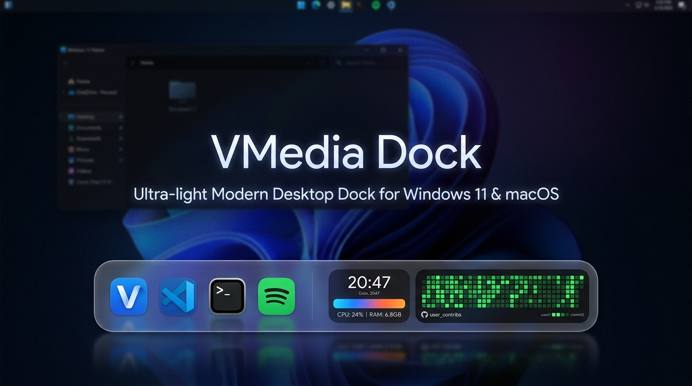

<p align="center">
  
</p>

<p align="center">
  <strong>Dock moderno, ultra-leve (&lt; 45MB RAM) e personalizável para Windows 11 e macOS.</strong><br />
  Construído nativamente com <strong>Tauri v2 + Rust</strong>, <strong>React</strong>, <strong>TypeScript</strong> e <strong>Tailwind CSS</strong>.
</p>

<p align="center">
  <a href="#-recursos-principais">Recursos</a> •
  <a href="#-instalação--download">Download</a> •
  <a href="#-como-usar">Como Usar</a> •
  <a href="#-widgets-vivos">Widgets</a> •
  <a href="#-atualização-automática">Auto-Update</a> •
  <a href="#-construindo-a-partir-do-código">Build</a>
</p>

<p align="center">
  
  
  
  
</p>

---

## 💡 Sobre o Projeto

O **VMedia Dock** foi desenvolvido para oferecer a experiência mais refinada e fluida de um dock estilo macOS no Windows 11, sem abrir mão de desempenho extremo e baixo consumo de recursos.

Ao contrário de docks tradicionais em Electron (que consomem facilmente 300MB a 600MB de RAM), o VMedia Dock utiliza o **motor nativo em Rust do Tauri v2**, mantendo consumo de memória inferior a **45MB de RAM** e animações suaves a 60fps constantes aceleradas por GPU.

---

## ✨ Recursos Principais

### 🚀 Desempenho & Leveza
- **Consumo Mínimo de Hardware:** menos de 45MB de memória RAM em uso normal.
- **Boot Instantâneo:** inicializa em milissegundos e integra-se à bandeja do Windows (`System Tray`).

### 🎨 Visual Moderno (Glassmorphism & Temas)
- **Efeito Vidro Translúcido:** desfoque profundo e bordas luminosas estilo Windows 11 Acrylic / Mica.
- **3 Temas Embutidos:**
  - 🪟 *Vidro Translúcido (Glassmorphism)*
  - 🌑 *Escuro Fosco (OLED Dark)*
  - ⚡ *Cyber Neon*
- **Escala Flexível:** ajuste de tamanho dos ícones e altura da barra de 20px (mini) até 64px.

### 🗂️ Ambientes Virtuais Isolados (Workspaces)
- Crie múltiplos ambientes de trabalho para separar seus fluxos:
  - 💼 **Trabalho** (VS Code, Terminais, Cotas de IA, Métricas)
  - 🎮 **Pessoal / Lazer** (Navegador, Spotify, Discord, Clima)
  - 🎯 **Foco** (Pomodoro, Mini Terminal)
- **Atalhos Rápidos Globais:** alterne instantaneamente com `Ctrl + Alt + 1..9`.

### 🖥️ Múltiplos Monitores & Posicionamento Inteligente
- **Respeita a Barra de Tarefas do Windows:** o Dock ancora automaticamente acima da barra de tarefas oficial (`work_area`), evitando sobreposições indesejadas.
- **Mova entre Telas com 1 Clique:** selecione qual monitor exibir diretamente na tela de Ajustes.
- **Arraste Livremente:** alça lateral dedicada (`Grip`) para arrastar e soltar a barra onde você quiser.

### 🔄 Atualizações Automáticas com 1 Clique
- Integração nativa com o **GitHub Releases**.
- Notificação discreta com selo luminoso na barra do Dock.
- Atualização em 1 clique: baixa em segundo plano e reinicia o Dock automaticamente.

---

## 🧩 Widgets Vivos Integrados

| Widget | Descrição |
|---|---|
| **GitHub Contribuições** | Exibe suas contribuições reais e a grade de commits viva do seu perfil (`@username`) |
| **Cotas de IA (CodexBar)** | Monitoramento de limites e resets em tempo real de Claude Code, Cursor Pro, OpenAI e Gemini |
| **Monitor de Sistema** | Uso de CPU e Memória RAM em tempo real com alertas de estresse |
| **Tocando Agora** | Informações da música em reprodução no Spotify/Windows com controles |
| **Relógio & Calendário** | Data, dia da semana e horário ao vivo |
| **Timer Pomodoro** | Ciclos de foco configuráveis (15, 25, 45 ou 50 min) |
| **Clima ao Vivo** | Temperatura e condição do tempo para a sua cidade configurada |
| **Prateleira de Arquivos (Drop Zone)** | Gaveta temporária flutuante para segurar arquivos durante arrastos |
| **Mini Terminal** | Visualizador retrô com animação de fluxo de código |

---

## 📥 Instalação & Download

Você pode baixar a versão mais recente diretamente na aba de **[Releases](https://github.com/vagneralencar/vmedia-dock/releases)**:

1. Baixe o instalador `vmedia-dock_x.x.x_x64-setup.exe`.
2. Execute o assistente de instalação (NSIS).
3. O Dock iniciará automaticamente na base da sua tela.

---

## ⌨️ Atalhos de Teclado Globais

| Atalho | Ação |
|---|---|
| `Ctrl + Alt + 1..9` | Alternar diretamente para o Ambiente correspondente |
| `Ctrl + Alt + S` | Abrir / Ocultar a Janela de Ajustes |
| `Ctrl + Alt + Espaço` | Alternar visibilidade instantânea do Dock |
| `Ctrl + Alt + N` | Adicionar novo executável (.exe) ao ambiente atual |

---

## 🛠️ Construindo a partir do Código-Fonte

### Pré-requisitos
- [Node.js](https://nodejs.org/) (versão 18 ou superior)
- [Rust & Cargo](https://rustup.rs/) (ferramenta de compilação oficial)
- Dependências de build do [Tauri v2](https://v2.tauri.app/start/)

### Passo a Passo

```bash
# 1. Clone o repositório
git clone https://github.com/vagneralencar/vmedia-dock.git
cd vmedia-dock

# 2. Instale as dependências do frontend
npm install

# 3. Execute em modo de desenvolvimento com hot-reload
npm run tauri dev

# 4. Gere o instalador de produção (.exe / .msi)
npm run tauri build
```

O instalador compilado estará disponível em:
`src-tauri/target/release/bundle/nsis/`

---

## 🛡️ Segurança & Privacidade por Design

- **Zero Telemetria:** nenhum dado, uso ou métrica é enviado para servidores externos.
- **Validação Estrita de Binários:** validador nativo em Rust que impede a execução de scripts arbitrários ou injeções de parâmetros.
- **Execução Local:** todos os widgets (mídia, cotas de IA locais e hardware) rodam 100% no seu computador.

---

## 📄 Licença

Distribuído sob a licença **MIT**. Consulte `LICENSE` para mais detalhes.

Feito com dedicação por **VMedia Team**.
